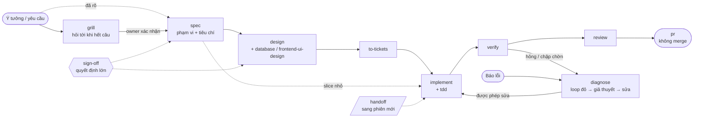

# sdlc-kit

Quy trình SDLC dùng lại được cho **Claude Code**, đóng gói thành một plugin để gắn vào mọi dự án bằng **git submodule**. Rút ra từ cách làm ở Fablewelf, AskPay, DataMate và G-Scores.

Plugin không chứa nghiệp vụ, stack hay deadline của dự án nào. Phần riêng của từng dự án nằm ở `AGENTS.md` của chính dự án đó (có template sẵn).

## Gồm những gì

```
.claude-plugin/marketplace.json   gốc repo là một marketplace (tên: sdlc-kit)
plugins/sdlc/
  skills/        14 skill: spec design implement verify review pr
                 + database frontend-ui-design to-tickets tdd sign-off
                 + grill diagnose handoff
  agents/        4 agent: repo_explorer implementation_worker test_engineer code_reviewer
  hooks/         guard-actions.mjs + hooks.json (PreToolUse cho Bash)
templates/       AGENTS.md, CLAUDE.md, settings.json để chép vào dự án
.agents/skills/  bản sao nguyên văn 14 skill + README liệt kê, để xem nhanh workflow có gì
tests/           test cho guard và test giữ bản sao không lệch (không đóng gói vào plugin)
```

Muốn biết workflow đang có những skill nào, mở [`.agents/skills/README.md`](.agents/skills/README.md). Claude Code không đọc thư mục này; nó chỉ để tham khảo.

Quy trình gói gọn trong một câu: **chọn đúng một skill cho việc đang làm, làm xong báo đúng cái đã chạy, đề xuất đúng một lệnh kế tiếp và không tự chạy.** Lập kế hoạch không có nghĩa là được viết mã; mở PR không có nghĩa là được merge; không động vào migration, dữ liệu thật hay deploy khi owner chưa đồng ý.

| Khi nào | Lệnh |
|---|---|
| Ý tưởng còn mơ hồ, muốn bị hỏi tới cùng trước khi spec | `/sdlc:grill <ý tưởng>` |
| Làm rõ hành vi, phạm vi, tiêu chí chấp nhận | `/sdlc:spec <phạm vi>` |
| Thiết kế luồng, giao diện module, hành vi khi lỗi | `/sdlc:design <slice>` |
| Dữ liệu, ràng buộc, migration | `/sdlc:database <phạm vi>` |
| Cắt spec thành việc nhỏ demo được | `/sdlc:to-tickets <spec>` |
| Viết mã cho slice **đã duyệt** (kèm `/sdlc:tdd`) | `/sdlc:implement <slice>` |
| Kiểm tra hành vi, báo cáo bằng chứng thật | `/sdlc:verify <phạm vi>` |
| Xem lại thay đổi (chỉ đọc) | `/sdlc:review <nhánh hoặc PR>` |
| Mở PR, không merge | `/sdlc:pr <phạm vi>` |
| Giao diện, a11y, responsive | `/sdlc:frontend-ui-design <màn hình>` |
| Quyết định ảnh hưởng phạm vi, an toàn, chi phí | `/sdlc:sign-off <quyết định>` |
| Bug khó, test chập chờn, chạy chậm | `/sdlc:diagnose <triệu chứng>` |
| Hết phiên / đầy context, chuyển việc sang phiên mới | `/sdlc:handoff <việc của phiên sau>` |

`implement`, `pr`, `sign-off`, `to-tickets`, `grill`, `handoff` chỉ chạy khi bạn gọi tay. `diagnose` có thể tự kích hoạt khi bạn báo lỗi, nhưng chỉ được sửa mã khi bạn cho phép.

## Workflow trông như thế nào



Đọc sơ đồ:
- **Mũi tên liền** là luồng thường gặp, **nét đứt** là đường tắt hoặc bước chỉ dùng khi cần. Không bước nào tự chạy bước kế tiếp: mỗi skill chỉ **đề xuất** một lệnh, bạn quyết định có gọi hay không.
- **`grill` đứng trước `spec`.** Dùng khi ý tưởng còn mơ hồ: agent hỏi theo vòng, mỗi câu kèm đáp án đề xuất, tự tra cứu dữ kiện trong repo, chỉ hỏi bạn những gì là *quyết định*. Kết thúc khi hết câu và bạn xác nhận bản tóm tắt, rồi mới sang `spec`.
- **`diagnose` là nhánh rẽ** từ `verify` hoặc từ một báo lỗi. Bắt buộc có một lệnh tái hiện lỗi (đỏ đúng triệu chứng, nhanh, ổn định) trước khi đoán nguyên nhân. Bản sửa đi qua `implement` + `tdd`, test hồi quy chính là lệnh tái hiện đã thu gọn.
- **`handoff` dùng ở bất kỳ điểm nào** khi phiên sắp hết context: ghi trạng thái, quyết định, đường dẫn và đúng một lệnh `/sdlc:*` để phiên mới chạy đầu tiên.

Ví dụ một vòng: `/sdlc:grill đăng nhập bằng email` → xác nhận tóm tắt → `/sdlc:spec đăng nhập bằng email` → `/sdlc:implement slice gửi magic link` → `/sdlc:verify` báo test hết hạn link chập chờn → `/sdlc:diagnose link hết hạn sớm` → được phép sửa → `/sdlc:verify` → `/sdlc:pr`.

## Gắn vào một dự án

Từ thư mục gốc của dự án (đường dẫn mẫu là `tools/sdlc-kit`):

```bash
# 1. Thêm submodule. Đừng đặt trong thư mục bị .gitignore (vendor/, node_modules/...).
git submodule add <url-repo-sdlc-kit> tools/sdlc-kit

# 2. Chép template, rồi sửa cho dự án. Nếu đã có file thì gộp tay.
cp tools/sdlc-kit/templates/AGENTS.md   AGENTS.md
cp tools/sdlc-kit/templates/CLAUDE.md   CLAUDE.md
mkdir -p .claude && cp tools/sdlc-kit/templates/settings.json .claude/settings.json

# 3. Đăng ký marketplace và cài plugin (một lần mỗi máy)
claude plugin marketplace add ./tools/sdlc-kit
claude plugin install sdlc@sdlc-kit --scope project
claude plugin list
```

Đổi đường dẫn submodule thì sửa `path` trong `extraKnownMarketplaces` của `.claude/settings.json` cho khớp. Sau khi cài, khởi động lại Claude Code rồi thử `/sdlc:spec <phạm vi>`.

**Clone dự án đã có submodule:**

```bash
git clone --recurse-submodules <url-du-an>
# hoặc, nếu đã clone:
git submodule update --init
```

**Cập nhật quy trình:**

```bash
git submodule update --remote tools/sdlc-kit
git add tools/sdlc-kit && git commit -m "chore: update sdlc-kit"
```

Mỗi dự án ghim vào một commit cụ thể, nên cập nhật ở repo này không làm vỡ dự án khác cho tới khi bạn chủ động nâng.

### Nếu dự án từng chép skill vào repo

Các repo cũ (Fablewelf, AskPay, DataMate, G-Scores) có `plugins/sdlc/`, `.agents/`, `.codex/`, hook `.claude/hooks/guard-actions.cjs` và marketplace riêng kiểu `<tên>-sdlc`. Khi chuyển sang submodule, gỡ các thứ đó đi, nếu không sẽ có **hai guard cùng chạy** và **hai plugin `sdlc` cùng đăng ký** các lệnh `/sdlc:*`:

1. Xoá `plugins/sdlc/`, `.agents/skills/`, `.claude-plugin/marketplace.json` cũ (và `.codex/` nếu không dùng Codex).
2. Xoá khối `hooks.PreToolUse` trỏ tới `guard-actions.cjs` và các mục `ask` về push/migrate/deploy trong `.claude/settings.json`. Hook trong plugin đã lo việc này. Nếu giữ `ask: ["Bash(git push *)"]` thì phần nới lỏng bên dưới không có tác dụng.
3. `claude plugin uninstall sdlc@<tên-cũ>` và `claude plugin marketplace remove <tên-cũ>`.
4. Giữ lại `AGENTS.md`: đó là phần riêng của dự án.

## Guard (`guard-actions.mjs`)

Hook đi kèm plugin nên không cần cấu hình thêm trong dự án. Nó tách lệnh thành từng lệnh thật sự được chạy (hiểu dấu nháy, `&&`, `|`, heredoc, `npx`, `pnpm exec`, `VAR=x`, `bash -c`), nên một commit message hay lệnh `grep` chỉ *nhắc tới* `git push --force` không bị chặn nhầm.

| Hành động | Kết quả |
|---|---|
| `git push --force`, `-f`, `+refspec` | **Chặn** |
| Push tới nhánh bảo vệ (`main`, `master`, `develop`, `production`, `staging`, `release/*`…), `git push` trần khi đang ở nhánh bảo vệ hoặc không xác định được nhánh, `--force-with-lease`, `--delete`, `--tags`, `--mirror`, `--all`, push lên remote `heroku`/`dokku` | Hỏi |
| Push lên nhánh thường (`git push -u origin feat/x`, `git push` khi đang ở `feat/x`) | Cho qua |
| `gh pr merge` | Hỏi |
| `prisma migrate reset/deploy/resolve`, `db push --accept-data-loss`, `db execute`; lệnh ORM có `drop/reset/rollback/undo/flush…` | Hỏi |
| `prisma migrate dev/status/diff`, `generate`, `db push`, `npm run seed`, `db:migrate`, `db:seed` | Cho qua |
| Mọi lệnh DB/seed/migrate nhắc `prod`/`production`/`staging` hoặc trỏ tới host không phải local | Hỏi |
| `DROP DATABASE/TABLE`, `TRUNCATE`, `DELETE FROM` không có `WHERE` (qua `psql`, `mysql`, `sqlite3`…) | Hỏi |
| Deploy/publish: `vercel`, `wrangler`, `netlify`, `firebase`, `fly`, `railway`, `render`, `heroku` (lệnh phát hành), `npm run deploy/release/publish`, `npm publish` | Hỏi |
| `docker volume prune`, `docker system prune --volumes` | Hỏi |
| `docker system prune` (không `--volumes`), `docker compose …` | Cho qua |

Đổi danh sách nhánh bảo vệ bằng biến môi trường (phân cách bằng dấu phẩy, hỗ trợ đuôi `*`): `SDLC_PROTECTED_BRANCHES="main,release/*"`.

Đây là lớp phòng thủ bổ sung, **không** phải ranh giới bảo mật: script gián tiếp, công cụ khác và lệnh gõ tay vẫn cần kiểm soát ở repo/môi trường. Việc "không commit, push, tạo PR, merge hay deploy khi owner chưa yêu cầu" vẫn là luật nằm ở `AGENTS.md`; hook chỉ là chốt chặn phụ. Hook không đọc được thư mục `.env`, nên việc cấm `Read(./.env)` nằm ở `templates/settings.json`.

## Phát triển repo này

```bash
npm test      # test cho guard (Node >= 18, không cần cài gì)
claude plugin validate .
claude plugin validate ./plugins/sdlc
```

Quy tắc:
- Bản chuẩn của skill là `plugins/sdlc/skills/`. Sửa ở đó rồi chép sang `.agents/skills/` (`cp -R plugins/sdlc/skills/. .agents/skills/`, giữ `README.md` của mirror); `npm test` báo lỗi nếu hai bên lệch.
- Skill và agent phải **tổng quát**: không đưa tên dự án, ID nghiệp vụ, đường dẫn, deadline hay stack cụ thể vào `plugins/sdlc/`. Những thứ đó thuộc `AGENTS.md` của dự án.
- Đổi hành vi plugin thì tăng `version` trong `plugins/sdlc/.claude-plugin/plugin.json` và gắn tag.
- Sửa luật trong `guard-actions.mjs` thì thêm ca vào `tests/guard-actions.test.mjs` cho cả hai hướng (cho qua và hỏi/chặn).
- `plugins/sdlc/skills/{tdd,grill,diagnose,handoff}/` phỏng theo [mattpocock/skills](https://github.com/mattpocock/skills), giấy phép MIT (`LICENSE.mattpocock` trong từng thư mục).
